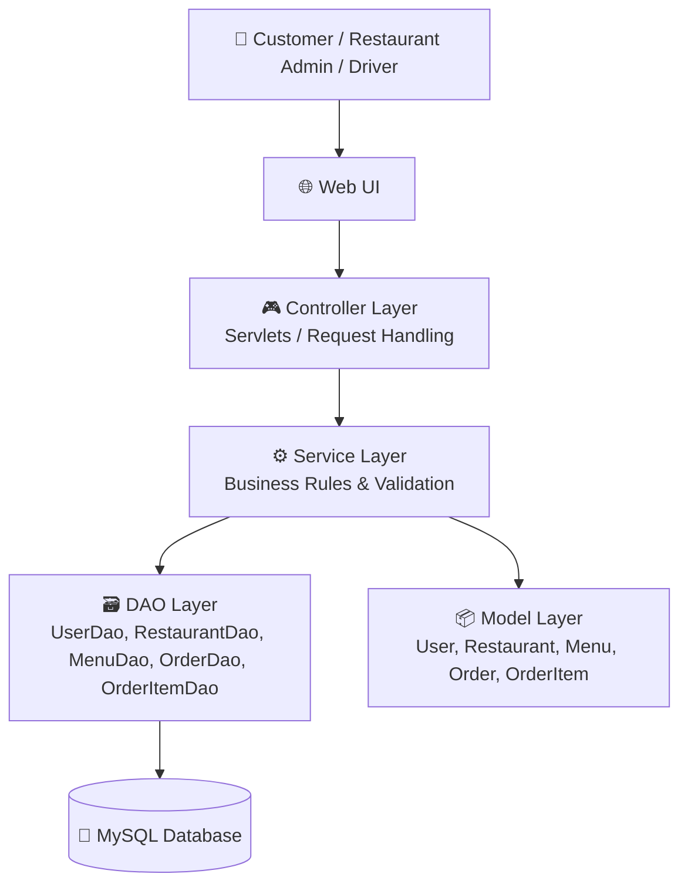
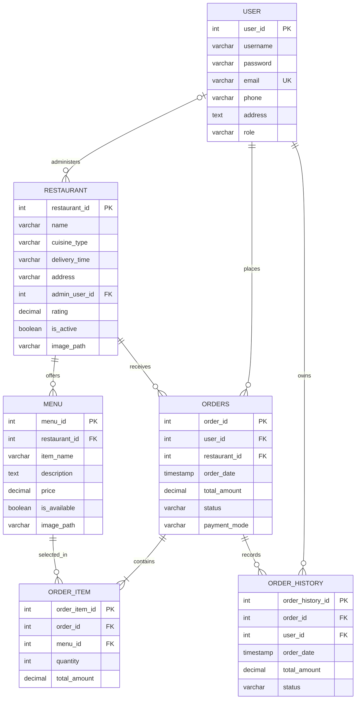
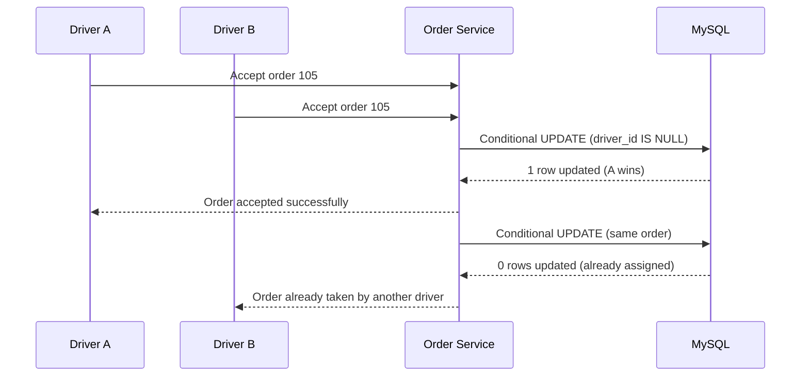

# 🍔 FoodExpress — Online Food Ordering & Delivery Management System

> A Java-based food ordering application backed by MySQL. FoodExpress organizes customers, restaurants, menu items, orders and order items, with a delivery-assignment workflow designed so that **one order can be assigned to only one delivery partner**.

---

## 📌 1. Project Overview

FoodExpress is designed to bring customers, restaurants and delivery partners into one food-ordering workflow. Customers can browse restaurants and menu items, place orders and review order information. Restaurant-side users manage restaurant/menu information, while delivery partners receive eligible orders and accept deliveries. An administrator can oversee platform data and user roles.

The uploaded project contains Java model classes, DAO interfaces, a MySQL schema with seed data, and a Jakarta web application configuration. The delivery-partner assignment workflow described in this README is the recommended implementation design; the uploaded SQL schema does **not yet contain a `driver` table, `driver_id` column, or atomic acceptance implementation**. Add the migration shown below before describing that workflow as implemented in a live build.

## 🎯 2. Problem Statement

Traditional or manually coordinated food ordering can create several problems:

- Customers need a convenient way to discover restaurants and menu items.
- Restaurant, menu, customer and order information can become difficult to maintain when kept separately.
- Order items and their parent order must remain correctly connected.
- Delivery assignment can create a race condition when two drivers try to accept the same order at nearly the same time.
- The system must clearly tell a second driver that the order has already been assigned, rather than allowing duplicate delivery assignments.

### 💡 Proposed Solution

FoodExpress stores the main business data in a relational MySQL database and organizes Java code into model and DAO layers. The order-assignment operation must be performed atomically in the database: only the first eligible driver can change an order from `AVAILABLE` to `ASSIGNED`. Every later attempt receives an “Order already taken” response.

## 👥 3. User Roles

| Role | Responsibility |
|---|---|
| Customer | Register/sign in, browse restaurants and menus, place orders, view order status/history. |
| Restaurant/Admin | Maintain restaurant information and menu items; review/manage orders according to permissions. |
| Delivery Partner (Driver) | View available delivery requests, accept one, and update delivery progress. |
| Administrator | Manage users and oversee application data. |

> Role-specific screens and authorization should be enforced in the web/controller layer. The provided schema stores a `role` field in `user`; it currently seeds `ADMIN` and `CUSTOMER` examples.

## ✨ 4. Main Features / Functional Modules

### 🔐 User Management
- User records with username, email, password, phone and address.
- Email is unique in the database.
- Role field supports role-based application behavior (for example, `ADMIN`, `CUSTOMER`, and, after extension, `DRIVER`).
- Create, read, update and delete operations are represented by `UserDao`.

### 🏪 Restaurant Management
- Restaurant name, cuisine, delivery-time estimate, address, rating, active status and image path.
- Restaurant is associated with an administrator/user through `admin_user_id`.
- Add, retrieve, list, update and delete operations are represented by `RestaurantDao`.

### 🍽️ Menu Management
- Menu items belong to a restaurant.
- Each item stores its name, description, price, availability and image path.
- Menu items can be listed by restaurant.
- Add, retrieve, update and delete operations are represented by `MenuDao`.

### 🛒 Order Management
- A customer places an order with a restaurant.
- An order stores customer, restaurant, date, total amount, status and payment mode.
- `OrderDao` represents order CRUD and customer-specific order retrieval.

### 🧾 Order Items
- Each order can contain multiple menu items.
- Each order item stores the menu reference, quantity and line total.
- `OrderItemDao` supports retrieval of items belonging to a particular order.

### 🕘 Order History
- The schema includes `order_history` to retain order-related history records.
- History rows reference both the order and customer.
- The application should insert history entries when relevant status transitions occur, ideally in the same database transaction as the status change.

### 🚴 Single-Driver Order Acceptance (Concurrency-Safe Design)
- Drivers should see orders that are still available for delivery.
- The first driver to accept an order becomes its assigned driver.
- A second driver attempting to accept that same order must not overwrite the first driver.
- The second driver receives a clear message: **“This order has already been taken by another delivery partner.”**
- The order must have one assigned driver at a time.

**Important:** The current uploaded `orders` table has no `driver_id` column and the uploaded Java source has no driver DAO/service/controller implementation. The following section documents the correct design to add this feature.

## 🧰 5. Technology Stack (Verified from the uploaded project)

| Area | Technology |
|---|---|
| Programming language | Java 21 (project facet configuration) |
| Web application standard | Jakarta Servlet / Jakarta EE Web 5.0 configuration |
| Web server | Apache Tomcat 10.1 (Eclipse project facet) |
| Database | MySQL |
| Database script | `foodexpress_schema.sql` |
| IDE/project metadata | Eclipse Dynamic Web Project |
| Data access structure | DAO interfaces |
| Domain objects | Java model/POJO classes |

The uploaded archive does not contain Spring Boot configuration, REST controller classes, JSP/HTML application pages, JDBC DAO implementation classes, or a build file such as Maven `pom.xml`/Gradle configuration. Do not list those as implemented technologies unless they exist in your complete working project.

## 🏛️ 6. Project Architecture

FoodExpress follows a **layered architecture with a DAO (Data Access Object) pattern**. The intended web structure is MVC-style: the web/controller layer receives requests, the model represents data, and DAO classes isolate database access. The archive currently provides model classes and DAO interfaces; the controller and DAO implementation layers are not present in this upload.



### Layer Responsibilities

1. **Presentation layer:** Displays forms, restaurant/menu data, cart/order information and delivery status. It sends user actions to controllers.
2. **Controller layer:** Accepts HTTP requests, validates request parameters and selects the appropriate service operation. In a Servlet implementation, this role is handled by servlets.
3. **Service/business layer:** Applies rules such as valid order creation, stock/menu availability, order status transitions and single-driver assignment.
4. **DAO/data-access layer:** Encapsulates SQL operations. The project contains DAO interfaces for users, restaurants, menus, orders and order items.
5. **Model layer:** Java POJOs represent the main entities and their fields.
6. **Database layer:** MySQL stores entities, relationships, constraints and order history.

## 🧩 7. Design Patterns and Programming Concepts

### Patterns evidenced by the uploaded source

- **DAO (Data Access Object) Pattern:** `UserDao`, `RestaurantDao`, `MenuDao`, `OrderDao` and `OrderItemDao` define data-access operations separately from model classes.
- **POJO / JavaBean-style Model:** `User`, `Restaurant`, `Menu`, `Order` and `OrderItem` contain private fields with constructors and getters/setters.
- **Layered Architecture:** Model and DAO responsibilities are separated. The full controller/service implementation is not included in this archive.

### Architecture/design approach recommended for the complete application

- **MVC (Model–View–Controller):** Use controllers/Servlets to handle requests, model objects for data and JSP/HTML views for presentation. The uploaded `web.xml` configures the web application, but no controller/view source is included in the archive.
- **Service Layer:** Keep business rules out of Servlets and DAO classes. For example, `OrderService.acceptOrder(orderId, driverId)` should coordinate the assignment rule.
- **Transaction management:** Use a database transaction for multi-step operations such as creating an order and its order items, or changing order status and recording history.

### Core Java / database concepts

- Encapsulation through private fields and public accessors.
- Classes, objects, constructors and method contracts through interfaces.
- Abstraction through DAO interfaces.
- CRUD operations (Create, Read, Update, Delete).
- Relational database design, primary keys and foreign keys.
- One-to-many relationships (restaurant → menus; order → order items).
- Referential integrity and delete behavior (`CASCADE`, `SET NULL`).
- SQL joins for retrieving related order, restaurant, menu and customer data.
- Transactions, conditional updates and concurrency control for safe driver assignment.

## 🗄️ 8. Database Architecture

The provided SQL script creates the `foodexpress` database and these six tables:

| Table | Purpose | Important relationship |
|---|---|---|
| `user` | Customer/admin account data and role | Parent of customer orders; can administer restaurants |
| `restaurant` | Restaurant profile and operational details | References `user.user_id` through `admin_user_id` |
| `menu` | Restaurant menu items | References `restaurant.restaurant_id` |
| `orders` | Order header: customer, restaurant, amount, status, payment mode | References `user` and `restaurant` |
| `order_item` | Individual items and quantities in an order | References `orders` and `menu` |
| `order_history` | Historical order snapshots/status records | References `orders` and `user` |

### 🧬 Entity Relationship Diagram — Current Uploaded Schema



### 🔗 Relationship Explanation

- One user/customer can place many orders; each order belongs to one customer.
- One restaurant can receive many orders; each order is associated with one restaurant.
- One restaurant can offer many menu items; each menu item belongs to one restaurant.
- One order contains multiple order-item rows; each order-item row points to one menu item.
- One order can have multiple history entries over its lifecycle.
- A user can administer multiple restaurants; a restaurant's `admin_user_id` can be null because the foreign key uses `ON DELETE SET NULL`.

### 🧱 Database Design Notes

- Primary keys uniquely identify records and are auto-incremented.
- Foreign keys maintain relationships between parent and child tables.
- `email` is unique in the user table.
- Monetary values use `DECIMAL(10,2)` in SQL to avoid floating-point currency storage.
- `ON DELETE CASCADE` is used for menu→restaurant, order-item→order/menu, and selected order/history relationships as defined in the script. Review these deletion rules carefully for production; historical orders are often better retained using soft deletion or restricted deletes.
- The Java models currently use `double` for some monetary fields. For financial correctness, prefer `BigDecimal` in Java to match MySQL `DECIMAL`.
- The sample SQL inserts plain-text example passwords. A real application must store salted password hashes (for example, BCrypt/Argon2), never plaintext passwords.

## 🚴 9. Important Technical Challenge: Two Drivers Accepting the Same Order

### Problem scenario

Suppose order `#105` is waiting for a driver. Driver A and Driver B both see it as available. They tap **Accept** at almost the same time. If the application first reads the order and later performs an unconditional update, both requests may believe they succeeded. This is a **race condition**.

### Why a `driver_id` can remain NULL

In the uploaded schema, the `orders` table does not define a `driver_id` column at all. Therefore, this exact archive cannot persist a driver assignment. If your local working database has a `driver_id` column but it remains `NULL`, likely causes include: the update is not executed, the wrong column/parameter is used, the transaction is rolled back, or the application checks availability but never commits the assignment. Verify the actual schema and DAO implementation.

### Recommended database change

The following is a migration example. It assumes drivers are represented as users whose `role` is `DRIVER`. If your application has a separate driver profile table, use that table as the foreign-key target instead.

```sql
-- 1) Extend order status to include delivery assignment states.
-- Existing status is VARCHAR, so no enum migration is required.

-- 2) Add the assigned driver reference.
ALTER TABLE orders
    ADD COLUMN driver_id INT NULL,
    ADD COLUMN accepted_at TIMESTAMP NULL,
    ADD CONSTRAINT fk_orders_driver
        FOREIGN KEY (driver_id) REFERENCES `user`(user_id)
        ON DELETE SET NULL;

-- 3) Optional but recommended: index common driver/order lookups.
CREATE INDEX idx_orders_status ON orders(status);
CREATE INDEX idx_orders_driver ON orders(driver_id);
```

### Atomic acceptance — the key solution

Do **not** implement acceptance as “SELECT available order, then UPDATE it” without locking/conditional protection. Use one conditional update so only one request can change the row:

```sql
UPDATE orders
SET driver_id = ?,
    status = 'ASSIGNED',
    accepted_at = CURRENT_TIMESTAMP
WHERE order_id = ?
  AND driver_id IS NULL
  AND status IN ('PENDING', 'READY_FOR_PICKUP');
```

Then check the number of affected rows:

- `1 row updated` → this driver successfully accepted the order.
- `0 rows updated` → the order is already assigned, no longer eligible, or does not exist. Query the order to return the correct message.

Because the condition and update execute as a single SQL statement, concurrent requests cannot both successfully claim the same row. The database serializes conflicting row updates; the second request re-evaluates the condition after the first update and affects zero rows.

### Java/JDBC service pseudocode

```java
public boolean acceptOrder(int orderId, int driverId) throws SQLException {
    String sql = "UPDATE orders " +
        "SET driver_id = ?, status = 'ASSIGNED', accepted_at = CURRENT_TIMESTAMP " +
        "WHERE order_id = ? AND driver_id IS NULL " +
        "AND status IN ('PENDING', 'READY_FOR_PICKUP')";

    try (Connection con = dataSource.getConnection();
         PreparedStatement ps = con.prepareStatement(sql)) {
        ps.setInt(1, driverId);
        ps.setInt(2, orderId);
        int rowsUpdated = ps.executeUpdate();
        return rowsUpdated == 1;
    }
}
```

The controller can then respond based on the result:

```text
if acceptOrder(...) is true:
    show "Order accepted successfully."
else:
    show "This order has already been taken by another delivery partner."
```

In production, also validate that the requesting account is an active driver, that the order is in a permitted state, and that the driver is eligible to accept it. Do not trust a `driverId` supplied by the browser; derive it from the authenticated session.

### Sequence diagram — two drivers compete



### Suggested order status lifecycle

```text
PENDING → ACCEPTED_BY_RESTAURANT → READY_FOR_PICKUP
        → ASSIGNED → PICKED_UP → OUT_FOR_DELIVERY → DELIVERED

Alternative terminal states: CANCELLED / FAILED
```

Choose one consistent status vocabulary in code and database. The current seed schema defaults to `Pending`; normalize status values (for example, uppercase constants) before implementing the workflow.

## 🔄 10. Typical End-to-End Workflow

1. Customer registers or signs in.
2. Customer browses active restaurants.
3. Customer selects a restaurant and views available menu items.
4. Customer selects quantities and submits an order.
5. Application creates an `orders` row and corresponding `order_item` rows in one transaction.
6. Restaurant/admin processes the order and updates its status.
7. Eligible drivers view orders available for delivery.
8. A driver accepts an order using the atomic conditional update.
9. The first successful driver is assigned; competing drivers receive the “already taken” message.
10. Driver updates delivery progress; customer can view the latest order status.
11. Status changes are recorded in `order_history`.

## 🗂️ 11. Project Folder Structure (from the uploaded archive)

```text
FoodExpress/
├── foodexpress_schema.sql
└── src/
    └── main/
        ├── java/
        │   └── com/tap/
        │       ├── controller/       # Directory exists; no controller source in archive
        │       ├── dao/
        │       │   ├── UserDao.java
        │       │   ├── RestaurantDao.java
        │       │   ├── MenuDao.java
        │       │   ├── OrderDao.java
        │       │   └── OrderItemDao.java
        │       ├── daoImpl/           # Directory exists; no implementation source in archive
        │       ├── model/
        │       │   ├── User.java
        │       │   ├── Restaurant.java
        │       │   ├── Menu.java
        │       │   ├── Order.java
        │       │   └── OrderItem.java
        │       └── util/              # Directory exists; no utility source in archive
        └── webapp/
            ├── META-INF/
            └── WEB-INF/web.xml
```

## ⚠️ 12. Challenges and Solutions

| Challenge | Why it happens | Recommended solution |
|---|---|---|
| Two drivers accept one order | Concurrent requests create a race condition | Conditional atomic `UPDATE`; check affected-row count |
| `driver_id` remains NULL | Current archive has no driver column; or assignment update is missing/rolled back in local code | Apply schema migration, verify prepared-statement parameters and commit behavior |
| Second driver sees a stale available order | Driver screen may display cached data | Revalidate on server/database at acceptance time; refresh the list after failure |
| Order and order items become inconsistent | Header and item inserts are separate operations | Insert both inside one database transaction; rollback on any failure |
| Invalid menu item/order quantity | Client input may be stale or manipulated | Validate menu availability, quantity and price on the server before creating order |
| Duplicate user accounts | Multiple registrations use the same email | Unique email constraint and friendly duplicate-key handling |
| Incorrect currency calculations | Java `double` can introduce floating-point rounding | Use `BigDecimal` in Java and `DECIMAL(10,2)` in MySQL |
| Password exposure | Plain-text sample password column/seed values | Hash passwords with a modern password-hashing algorithm; never log credentials |
| History not matching order status | Status and history inserted in separate operations | Update order and insert history in one transaction |

## 🧪 13. Testing Scenarios

- Register two users with different emails; confirm both can be stored.
- Register duplicate email; confirm the database rejects it and UI shows a useful message.
- Add a restaurant and multiple menu items; confirm menu items reference the correct restaurant.
- Place an order with multiple items; confirm one order header and all order-item rows are stored.
- Request an order's items; confirm only items for that order are returned.
- Make two driver requests for the same order concurrently; confirm exactly one update affects one row.
- Retry acceptance after assignment; confirm the second driver receives the “already taken” message.
- Attempt acceptance for a cancelled/delivered order; confirm it is rejected.
- Force an error while saving order items; confirm the order transaction rolls back.

## 🚀 14. Setup Guide

### Prerequisites
- JDK 21 (matching the Eclipse project facet).
- MySQL Server and MySQL Workbench (or another MySQL client).
- Apache Tomcat 10.1.
- Eclipse IDE for Enterprise Java and Web Developers (or compatible IDE).

### Database setup
1. Open MySQL Workbench and connect to your local MySQL server.
2. Open `foodexpress_schema.sql` from this project.
3. Execute the script to create the `foodexpress` database, tables and sample records.
4. Refresh the Schemas panel and verify the six tables: `user`, `restaurant`, `menu`, `orders`, `order_item`, `order_history`.
5. If implementing driver assignment, execute the migration in Section 9 after confirming the driver-account design.

### Import/run notes
1. Import the project into Eclipse as an existing Dynamic Web Project.
2. Configure JDK 21 and Apache Tomcat 10.1 in the IDE.
3. Configure your JDBC connection settings in the application's database utility/DAO implementation (not included in this uploaded archive).
4. Add/verify the missing Servlet/controller, service, DAO implementation and view files in your complete source project.
5. Run the project on Tomcat after the application entry page and request mappings are present.

> The uploaded ZIP is a partial project snapshot: it includes schema, models, DAO interfaces and `web.xml`, but not enough source code to launch the complete user-facing application by itself.

## 🔮 15. Future Enhancements

- Secure authentication, password hashing and session management.
- Dedicated driver profile table with availability, vehicle and contact details.
- Driver location tracking and map integration.
- Payment gateway integration and payment transaction records.
- Notifications for order confirmation, driver assignment and delivery updates.
- Restaurant-side order dashboard.
- Ratings and reviews for restaurants and delivery partners.
- Search, cuisine filters and menu recommendations.
- Pagination, database indexes and audit logging.
- Automated unit, integration and concurrent-acceptance tests.

## 🏁 16. Project Outcome

FoodExpress demonstrates how a Java web application can organize food-ordering data using relational database design, Java model classes and DAO abstractions. Its most important delivery-workflow requirement is preventing duplicate driver assignment. The robust solution is to make acceptance a single conditional database update and treat the affected-row count as the source of truth.

---

### 📚 Key Interview Explanation

**“FoodExpress is a Java and MySQL-based food ordering and delivery management application. It organizes customers, restaurants, menus, orders and order items using a layered architecture and DAO pattern. One important concurrency problem is that two drivers may try to accept the same order simultaneously. I handle this safely with a conditional database update that assigns the order only when no driver is assigned; the first request succeeds, and the next driver receives an ‘order already taken’ message.”**

